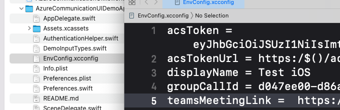
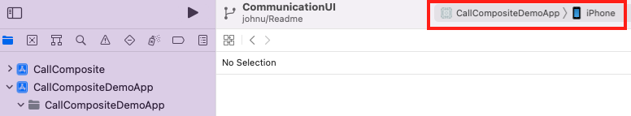

# UI Mobile Library Demo App 

The sample app is a native iOS application developed using both SwiftUI and UIKit frameworks. It uses the Azure Communication UI library to empower the user experience.

## Getting Started

### Prerequisites

- An Azure account with an active subscription. [Create an account for free](https://azure.microsoft.com/free/?WT.mc_id=A261C142F).
- A Mac running [Xcode](https://go.microsoft.com/fwLink/p/?LinkID=266532) 26.4 or later, along with a valid developer certificate installed into your Keychain. Dependencies are fetched with Swift Package Manager.
- A deployed Communication Services resource. Create a [Communication Services resource](https://docs.microsoft.com/azure/communication-services/quickstarts/create-communication-resource).
- Azure Communication Services Token. [See example](https://docs.microsoft.com/en-us/azure/communication-services/quickstarts/identity/quick-create-identity).
- (Optional) Create Azure Communication Services Token service URL. [See example](https://docs.microsoft.com/azure/communication-services/tutorials/trusted-service-tutorial).

### Before running the sample for the first time

1. Clone the [Repo](https://github.com/Azure/azure-communication-ui-library-ios) in your local environment.
2. (Optional) Install [SwiftLint](https://github.com/realm/SwiftLint) 0.53.0 or later. The sample's build phases lint the code when SwiftLint is installed.
3. (Optional) cd to the <project_folder>/AzureCommunicationUI/AzureCommunicationUIDemoApp/Sources folder.
4. (Optional) Run `touch EnvConfig.xcconfig` via the Command Line. 
5. (Optional) Add constants from following list to `EnvConfig.xcconfig` as the sample app's local configurations. 
   - Shared:
      - `acsToken`: a generated Azure Communication Services token
      - `acsTokenUrl`: the URL to request Azure Communication Services token (You must use https:/$()/ in the format of URL)
      - `displayName`: your preferred display name
   - for Calling:
      - `expiredAcsToken`: an expired Azure Communication Services token for UI testing
      - `groupCallId`: this a type of UUID used to start and join a meeting for Calling
      - `teamsMeetingLink`: the URL to a Teams meeting (You must use https:/$()/ in the format of URL) for Calling
      - `roomCallId`: the generated ID to join a room call meeting
      - `roomCallRole`: the type of role used to join a room call meeting
      - `aadToken`: the AAD token for Calling
      - `participantMRIs`: the MRIs for remote participants to dial

    

    Note: The `EnvConfig.xcconfig` file is created strictly for developers convenience. Those configurations can be input once the `AzureCommunicationUIDemoApp` is running.

### 1 to N Calling Push Notifications Setup

1. Follow [QuickStart](https://learn.microsoft.com/en-us/azure/communication-services/how-tos/ui-library-sdk/one-to-one-calling?tabs=kotlin&pivots=platform-ios) to setup Push Notification Hub for ACS Resource or EventGrid
2. For `AzureCommunicationUIDemoApp` add `Push Notification` Capability
3. Add `AzureCommunicationUIDemoAppExtensions` into Frameworks for `AzureCommunicationUIDemoApp`
4. Change `AzureCommunicationUIDemoApp` to profile supporting `Push Notification`

### Run Sample

1. Open the `AzureCommunicationUI/AzureCommunicationUI.xcworkspace` file. Xcode resolves the Swift packages, including the local `AzureCommunicationUICalling` package from the repository root.
2. Select `AzureCommunicationUIDemoApp` scheme and target at any iOS simulator/device.
3. Hit `Run` or `⌘+R` to start running.

    
    
